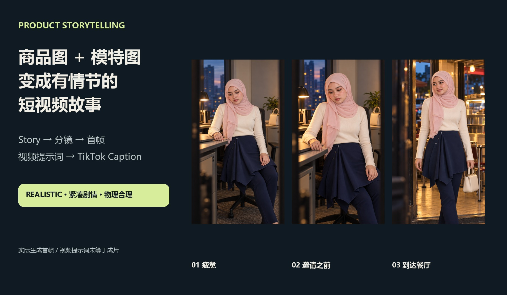
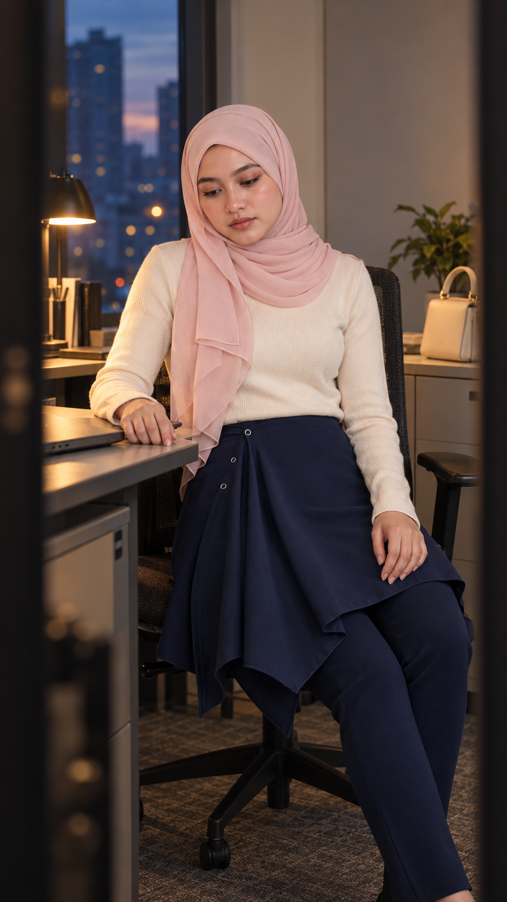
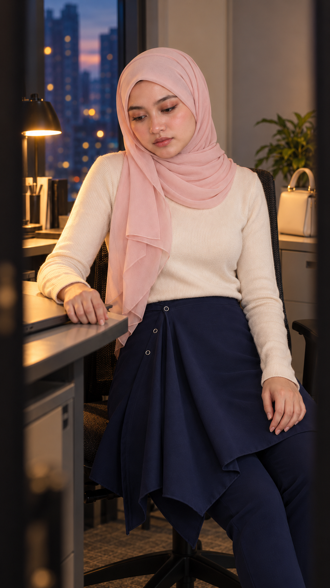
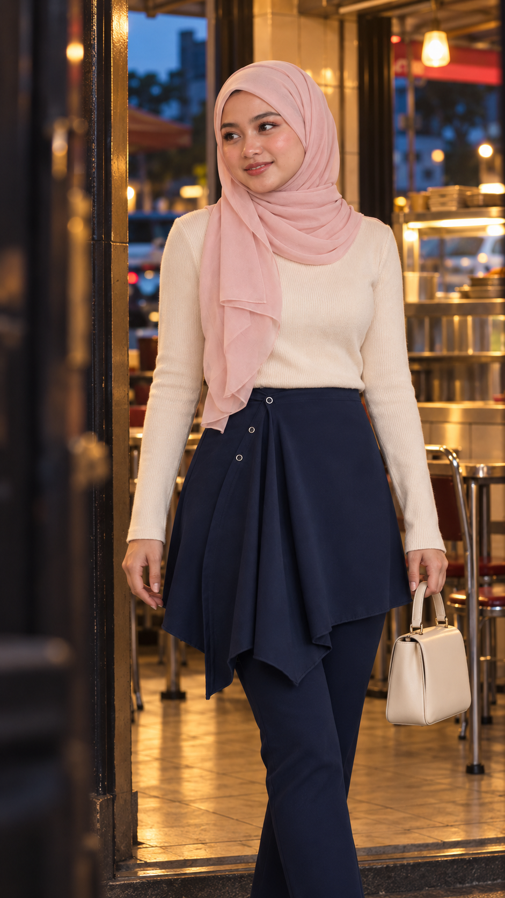

# Product Storytelling Studio · 商品故事分镜工作室

**当前版本：v1.1.0** · [更新记录](CHANGELOG.md)

**商品图 + 模特参考图 → Story → 分镜 → 首帧图片 → 视频提示词 → TikTok Caption**

把商品放进有起因、有行动、有结果的故事。支持服装和一般实体商品，适合马来西亚商品 TVC、UGC、穿搭故事及 TikTok 内容。

## 直接开始

把商品图和可选模特图发给 Codex，复制：

~~~text
使用 $product-storytelling-studio。

第一张是商品，第二张是模特。
先给我3个不同方向的TVC短视频脚本，每个3幕，每幕8秒、2镜。
故事要紧凑、有反差，动作和物理关系合理。
人物、背景和皮肤全部Realistic。
马来西亚马来语对白。
最后附带Hook的TikTok Caption。
~~~

上面的示例明确要求“先给脚本”，因此停在文字阶段。完整任务的顺序是 Story → 分镜 → 实际生成并检查首帧图 → 根据选定图片写视频提示词 → 最后写 Caption。实际生成视频仍需明确要求，并指定平台和输出范围。

## 图文导航

| 想做什么 | 打开 |
|---|---|
| 安装、更新、卸载 | [安装指南](docs/installation.md) |
| 第一次使用、素材怎样发 | [使用教程](docs/usage.md) |
| 直接复制完整指令 | [指令库](docs/commands.md) |
| 选风格、模板、语气和节奏 | [完整参数导航](docs/options.md) |
| 看31种电影观感样品 | [图文风格图库](gallery/README.md) |
| 查看真实首帧与完整脚本 | [示例目录](examples/README.md) |
| 处理拿物、衣服垂落、说话人问题 | [连续性与声音示例](docs/continuity.md) |
| Omni提示词输入模式与写法 | [Omni写作参考](skills/product-storytelling-studio/references/omni-prompt-writing.md) |
| 下载仅含Skill的安装包 | [product-storytelling-studio.zip](dist/product-storytelling-studio.zip) |

## 安装

在 Codex 中复制：

~~~text
使用 $skill-installer，从这个GitHub仓库安装Skill：
https://github.com/pusatpakaiankime-bit/product-storytelling-studio
路径：skills/product-storytelling-studio
~~~

私有仓库需要当前账号有访问权限。完整手动安装和本地安装脚本见[安装指南](docs/installation.md)。安装后在下一轮对话调用 $product-storytelling-studio。

## 已设定的创作偏好

- 人物、背景、皮肤默认 **Realistic**，竖屏 **9:16**。
- 默认 **1位主角、3幕×8秒、每幕1–2镜**；用户可覆盖。
- 明确带货用途时，默认 **亢奋／高能兴奋、强情绪**；剧情需要疲惫或犹豫铺垫时保留反差。
- 故事尽早进入事件，每幕推进，不靠长时间摆拍或发呆填时长。
- 检查重力、支撑、握持、朝向和跨镜连续性。单手单点提衣服时，未支撑的布料自然下垂。
- 马来西亚项目默认中文说明、马来西亚马来语对白、英文生成提示词。
- TikTok项目末尾默认附 **Hook + 共鸣 + 互动问题 + 相关标签**。
- 具体要求优先，例如无对白、慢节奏、动画、其他语言或自定义参数。

## 能力范围

| 项目 | 内容 |
|---|---|
| 故事模式 | Cinematic、Timelapse、Narrative |
| 过程模板 | 9种 |
| 旁白风格 | 4种 |
| 视觉风格 | 9项 |
| 电影观感 | 31项，配31张独立生成样品 |
| 语气 | 24种本地预设，支持自定义 |
| 摄影 | 14种运镜／机位／景别／对焦选项 |
| 灯光与皮肤 | 5种灯光、3种皮肤质感 |
| 节奏 | 幕数、单幕时长、镜头密度、停顿及语速安排 |
| 交付 | 完整任务依次给故事、分镜、实际首帧图、基于出图的视频提示词，最后 Caption；实际视频按要求生成 |

## 一个成图案例

《上班电量1%，听到吃饭瞬间满格》：她下班前只想回家，听到邀请后立刻精神起来，拿包前往Mamak，笑着说“Penat kerja. Makan tak penat!”

| 疲惫铺垫 | 邀请发生前 | 餐厅到达 |
|---|---|---|
|  |  |  |

[看完整故事、分镜和视频提示词](examples/work-to-makan/story-and-video-prompts.md)。前两张首帧相近，是因为第二幕的兴奋发生在视频中听到邀请之后。

## 来源与结果说明

这是独立编写的创作Skill，不是Studiova后台系统提示词。历史选项目录记录于2026-10-12；价格、模型标签和能力需要在实际执行前核实。风格图库是独立AI生成的视觉解读。示例中有真实生成的静态首帧；标为Proposed的视频提示词尚不等于已生成成片。

核心Skill、图文与脚本在仓库中分别维护：仅安装Skill不需要下载整个图片图库。

