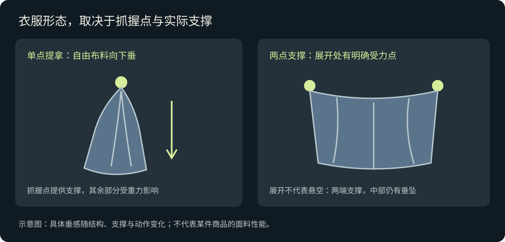

# 动作、布料与声音连续性

## 衣服由什么支撑

- 单手只提住软质衣服的一点：自由布料由抓握点向下垂，出现合理褶皱。
- 两手展开、衣架悬挂或穿在人体上：形状由实际支撑决定。
- 转身、走动、停步：布料随动作摆动，延迟回落。
- 松手：落向地面或已明确的承托面。
- 有结构性的领口或硬质部分可以保持形状，但不能让整件软衣服无支撑平展。

## 拿包的顺序

物体还在台面 → 手接触提把 → 手指握稳 → 提离台面 → 垂到身侧。换手或收纳应有可见动作，或明确的省略剪辑。手已经拿东西时，不同时给它分配另一件任务。

## 反差、无厘头与错误

笑点可以夸张。观众仍需知道触发了什么、人物为什么反应。若有明确设计的超现实规则，就说明触发方式；不要把手机翻面、声音说错人、衣服无支撑悬空当作无厘头。

## “Jom makan!”被谁说

原故事：朋友邀请，主角回应。若生成把两句都分给主角，就会像自问自答。
该案例修正为：
- 视频生成：主角先闭嘴倾听，再说“Dekat mana?!”
- 后期音轨：朋友的“Jom makan!”单独加入，结束后主角才回应。
- [修正版视频提示词](../examples/work-to-makan/video-scene-02.txt)
- [朋友声音的后期安排](../examples/work-to-makan/scene-02-friend-voice-editing.txt)

这是针对说话人混淆的补救，不是强制所有故事无画外音。只有完成音轨制作、混音与验收，才能说声音已经验证。

