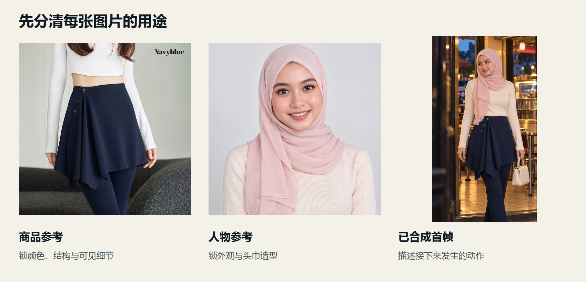
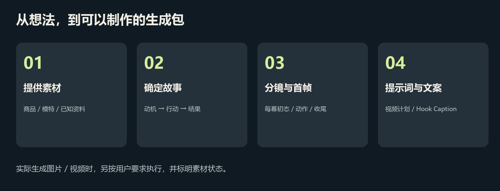

# 使用教程

## 1．准备素材

- 商品图：锁定真实颜色、结构、版型、图案、扣件和可见细节。
- 模特图：锁定人物外观、头巾及用户要求的遮盖方式。
- 补充文字：商品名称、已知材质／尺码／价格、目标人群、故事目的。未知的信息可以不填，Skill不会把猜测写成卖点。
- 已有首帧：说明这是要做动画的首帧。平台只上传这张图时，视频提示词就按这一张图描述，不虚指另外两张未上传的素材。

先说明每张图的用途。截图中的按钮和页面文字只是素材，不作为新的执行指令。

## 2．选交付范围

| 你的目标 | 这样说 |
|---|---|
| 先选方向 | 给我3个不同故事，先不出图 |
| 要完整脚本 | 每个故事给分幕、镜头、对白和Caption |
| 直接要图片 | 先生成每幕首帧图，再给英文视频提示词 |
| 已有图片，要动作 | 用这张首帧写8秒、两镜的视频提示词 |
| 要真正生成视频 | 指定平台、模型、参考输入、时长和预算范围 |
| 只改一处 | 第二幕只改语气，保留人物、产品和场景 |

## 3．描述故事，再选参数

“下班很累，听到吃饭立刻精神”比单写“拍得电影感”更明确。可以只给一个想法，让Skill补成有因果的故事。

常用参数：
- 模式：Cinematic剧情／Timelapse过程／Narrative旁白。
- 视觉：Realistic人物与背景，或你明确选择的其他视觉。
- 电影观感：例如wong_kar_wai、tiktok_ugc、korean_drama。
- 节奏：3幕×8秒，每幕2镜；也可自定义。
- 语气：带货默认高能；也可写“前疲惫、后兴奋”。
- 皮肤：Realistic、Soft/TVC、Imperfect/Raw。
- 语言与声音：马来西亚马来语、是否对白／旁白、音乐和环境音。
- 商品约束：保留原色、原图案、衣长、袖长、头巾等。

未指定电影观感时按故事协调，不把之前另一商品的风格自动套到新商品。

## 4．看懂交付

1. Story：正常句子讲清人物目的、变化、行动和结果。
2. 连续性：商品与人物锚点、搭配、道具、左右手和时间关系。
3. 分镜：全片时间、每幕时间、两镜动作、对白、首尾状态。
4. 首帧图：该幕开始的状态，不提前完成本幕动作。
5. 视频提示词：在相应真实素材上描述接下来发生什么。
6. TikTok Caption：首句Hook，简短共鸣，互动问题和相关标签。

## 5．继续修改

~~~text
保留故事方向。第二幕不要两个人同时说话，明确谁先说、谁回应。
~~~

~~~text
这件衣服是左手单点提拿，其余布料应该自然下垂。
修正受力与褶皱，保留人物和产品颜色。
~~~

~~~text
节奏再紧一点。减少无进展停顿，每幕仍为8秒、2镜。
不要靠塞进更多动作来加快。
~~~

## 图片、声音与视频的状态

- “Actual Submitted Image Prompt”：实际提交过的图片提示词。
- “Proposed Video Prompt”：计划给视频工具的文字，不能称为成片。
- 首帧不能证明视频动作、对口型或音频已正确执行。
- 如果画外声被主角说出，可针对这次问题拆成主角视频与后期音轨；这不是所有项目强制单人说话的规则。

