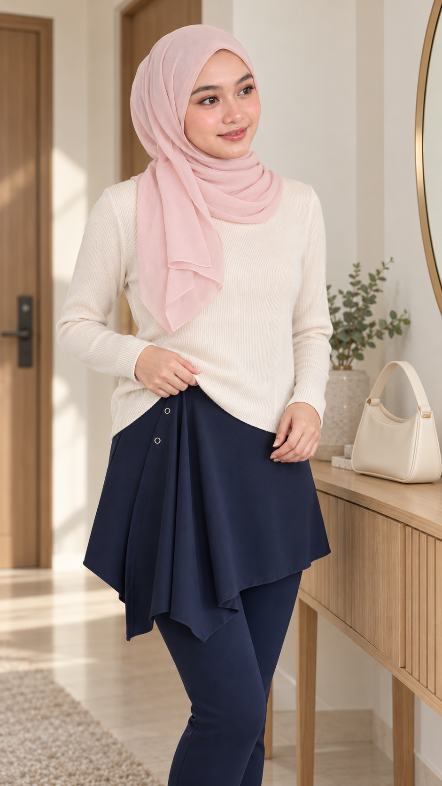
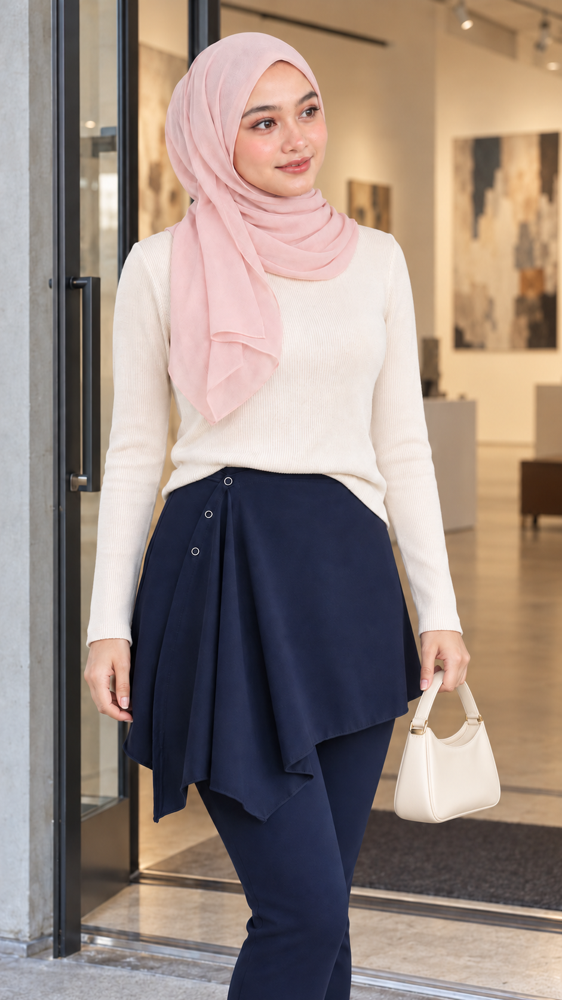

# 临出门的一个小调整

## 实际生成的三张首帧

| 第1幕 | 第2幕 | 第3幕 |
|---|---|---|
|  |  |  |

[商品参考](inputs/product.jpg) · [人物参考](inputs/model.png)


3 幕 × 每幕 8 秒 = 24 秒；每幕 2 镜，共 6 个计划镜头。1 位贯穿角色。自然写实、竖屏 9:16、自然肤质、柔和中性日光；本次自动选择日常摄影观感，没有沿用旧案例的王家卫选项。中文说明、马来西亚马来语对白、英文视频提示词。未指定视频平台或模型，未生成视频。

## Story

她准备去画廊赴约。临出门时，她望向镜子，发现浅色针织上衣遮住了深蓝裙裤的腰部细节。她把上衣前摆浅浅整理进腰线，让三枚银色圆环与不对称叠片露出来；随后从玄关台面拿起小包，朝门口走去。镜头跳到画廊，她看见画外的约会对象，点头微笑，一起进去看展。

## 参考与连续性

- 商品图仅锁定下装：深蓝色、贴合裤身外的不对称裙式叠片、画面左侧上部三枚银色圆环、向下垂的折片及右侧较短斜向下摆。圆环的功能与面料成分、弹性、舒适度、尺码、价格均未确认，不写为卖点。
- 模特图锁定脸部外观、粉色头巾及浅色长袖造型；新增奶油色针织上衣的具体搭配与无品牌米白小包，不作为商品附带物。生成图的皮肤细节较原图柔和，属于创作参考，不能视为严格身份复刻。
- 第一幕从前摆未整理开始，末尾完成浅前塞；第二、三幕保持整理状态。镜头不展示未提供参考的裤脚和背面。
- 小包在第一幕始终放台面；第二幕只用左手拿短提把，结束在左侧；第三幕继续左手提包。第二幕与第三幕之间是出发至到达的时间省略。

## 分镜

| 幕 | 全片时间 | 两镜安排（幕内时间） | 马来语对白 | 首尾状态 |
|---|---|---|---|---|
| 1 把细节露出来 | 0–8 秒 | 0–4 秒：中景，低头发现遮挡并开始整理前摆；4–8 秒：同侧腰部近景，完成浅前塞，双手离开并停留展示。 | Kejap… kemaskan depan sikit, baru nampak perincian dia. | 起：右手捏前摆、上部圆环被遮；终：三环与折片显露，小包留在台面。 |
| 2 拿包出发 | 8–16 秒 | 0–4 秒：左手握紧短提把，垂直提离台面后降至身侧；4–8 秒：切稍宽机位，朝门口走两步。 | Ha, nampak dah potongan dia. Jom, pergi tengok pameran. | 起：前摆已整理、左手接触包把、包底仍着台；终：左手提包朝门口走。 |
| 3 赴约看展 | 16–24 秒 | 0–4 秒：门口中景，向画外对象点头、笑意加深；4–8 秒：切画廊内斜侧机位，她转向门口并走入。 | Dah sampai. Jom, masuk sama-sama. | 起：已到画廊、左手提包；终：进入画廊，穿搭和提包手保持一致。 |

对白意思：①“等一下……把前面整理一下，细节才看得出来。”②“这样就看到剪裁了。走，去看展。”③“到了。走，一起进去。”

## 已生成图片的检查

三张最终图已目视检查：主色保持为深蓝，主要叠片和圆环可辨；第一张有圆环被上衣遮住，符合开场状态，第二和第三张三环露出。模特头巾及浅色长袖一致。第三幕曾出现长肩带，已定向改成左手持短提把；原输出与修正提示词记录在 production-record.json。

生成图的裙片下缘曲线与原商品照片存在细小变化，脸部与皮肤也有生成修饰，因此适合作为创意首帧，精确商品版型仍应以原图核对。只核对了静态画面；拿包、前塞、走路、对口型和声音尚未经视频生成验证。

## 使用

每段视频用对应 navy-scene-01/02/03.png 作首帧，配合下面的 Proposed Video Prompt。第 3 段使用修正后的手提包图。若平台无法稳定执行一段内两镜，可按切点分别生成后剪辑；时间码是创作计划。没有向 Studiova 或其他视频网站提交，也没有视频扣费记录。

## 第 1 幕：把细节露出来 — Proposed Video Prompt

```text
Planned duration: 8 seconds, two shots. Start from navy-scene-01.png. Keep the reference woman's facial appearance, blush-pink hijab and opaque cream long-sleeved knit top. Preserve the deep NAVY asymmetric skirt-like overlay over fitted trousers, three silver circular eyelet details diagonally down the viewer-left upper front, long pointed draped front fold and shorter diagonal viewer-right hem. Keep product orientation; do not mirror, turn it into a plain skirt, add fasteners, or change navy to black. Natural skin texture and neutral soft daylight. Vertical 9:16. No subtitles, text, label, watermark, music or extra visible people. Each numbered shot is a planned cut, not a guaranteed model control.
Initial state: apartment entrance beside the oak console; woman is looking toward the off-frame mirror, right thumb and fingers hold the loose front sweater hem, left hand is free near her waist. The sweater covers the upper ring. The small ivory bag stays upright on the console throughout this scene.
0.0–4.0 seconds, shot 1: continue the first frame at eye level. She lowers her eyes to the covered waistband. Her right hand gently lifts just the loose front hem, then the left hand helps fold a short central section inward into the waistband. Keep the abdomen covered. Her fingers manipulate only knit fabric, not the rings or navy overlay.
4.0–8.0 seconds, shot 2: cut on the hand action to a waist-to-upper-thigh close-up from the same front side. Finish the shallow front tuck once, revealing all THREE silver ring details and the original navy front folds. Both hands release and move clear of the garment. Hold the finished detail for the final 1.5 seconds. No repeated tucking or spontaneous fabric transformation.
Dialogue: same woman, quiet natural Malaysian Malay, starts at 0.4 seconds while she looks down: "Kejap… kemaskan depan sikit, baru nampak perincian dia." Let the remainder of the scene breathe.
Sound: low apartment room tone and soft fabric rustle.
End: front tuck complete, three rings visible, hands free; bag still on the console. No outfit change or camera flip.
```

## 第 2 幕：拿包出发 — Proposed Video Prompt

```text
Planned duration: 8 seconds, two shots. Start from navy-scene-02.png. Keep the reference woman's facial appearance, blush-pink hijab and opaque cream long-sleeved knit top. Preserve the deep NAVY asymmetric skirt-like overlay over fitted trousers, three silver circular eyelet details diagonally down the viewer-left upper front, long pointed draped front fold and shorter diagonal viewer-right hem. Keep product orientation; do not mirror, turn it into a plain skirt, add fasteners, or change navy to black. Natural skin texture and neutral soft daylight. Vertical 9:16. No subtitles, text, label, watermark, music or extra visible people. Each numbered shot is a planned cut, not a guaranteed model control.
Initial state: same daylight apartment entrance and oak console. The cream sweater's front tuck is ALREADY finished. The small ivory handbag is upright on the console with its SHORT single top handle. Her LEFT hand, visible on viewer-right, is already touching the apex of that handle; her right hand hangs free. Do not perform the tuck again.
0.0–4.0 seconds, shot 1: eye-level three-quarter medium shot continuing the first frame. Her left fingers close naturally around the short handle and thumb opposes them. Lift the bag vertically until its base clears the console by 10–15 cm; then lower the bag beside her left outer thigh. Keep one continuous left-hand grip, realistic gravity, same bag shape and short handle. Her right hand remains empty. Never put the bag on her shoulder or invent a long strap.
4.0–8.0 seconds, shot 2: cut to a slightly wider front three-quarter angle along her walking path toward the entrance. She takes two unhurried steps while the camera tracks back a short distance. Keep her front navy panel readable and the ivory bag at her left outer side. Stop before any door-opening action. Crop above the trouser hem, as the reference does not show its construction.
Dialogue: same woman, casual Malaysian Malay, begins at 0.5 seconds: "Ha, nampak dah potongan dia. Jom, pergi tengok pameran."
Sound: room tone, gentle handle movement and two quiet footfalls.
End: dressed and carrying the same bag by its short handle in her LEFT hand, on her way out. The next scene is an explicit time-and-location cut to arrival at the gallery.
```

## 第 3 幕：赴约看展 — Proposed Video Prompt

```text
Planned duration: 8 seconds, two shots. Start from navy-scene-03.png, the CORRECTED image with the ivory bag in her LEFT hand, not the earlier shoulder-bag version. Keep the reference woman's facial appearance, blush-pink hijab and opaque cream long-sleeved knit top. Preserve the deep NAVY asymmetric skirt-like overlay over fitted trousers, three silver circular eyelet details diagonally down the viewer-left upper front, long pointed draped front fold and shorter diagonal viewer-right hem. Keep product orientation; do not mirror, turn it into a plain skirt, add fasteners, or change navy to black. Natural skin texture and neutral soft daylight. Vertical 9:16. No subtitles, text, label, watermark, music or extra visible people. Each numbered shot is a planned cut, not a guaranteed model control.
Initial state: she stands just outside the already-open contemporary gallery entrance. Same finished front tuck and navy garment. The small ivory bag hangs beside her left outer thigh from its short handle, held by her left hand; her right hand is free. She is already looking toward an off-camera companion on her left with a soft smile, as shown in the first frame.
0.0–4.0 seconds, shot 1: eye-level head-to-knee view. Her smile gently grows and she gives one small greeting nod to the companion. No phone, waving or bag transfer. The garment and three rings stay visible; the bag remains beside her, clear of the front panel.
4.0–8.0 seconds, shot 2: cut to a camera just inside the gallery, looking diagonally toward the open doorway. She turns naturally toward that doorway and takes two steps inside toward the camera's three-quarter front view. This is an ordinary editorial angle change, not a mirror flip or backward walking. Keep her left hand holding the short bag handle. Allow only modest, gravity-driven movement in the navy overlay, maintaining its fold geometry and colour.
Dialogue: same woman, warm natural Malaysian Malay, starts at 0.6 seconds: "Dah sampai. Jom, masuk sama-sama." No visible second person and no additional response voice.
Sound: subdued gallery room tone and two light footfalls; no music.
End: she has entered the gallery to meet the companion, still in the same outfit, holding the same bag in the left hand. No purchase slogan, new accessory or unseen back-design claim.
```

