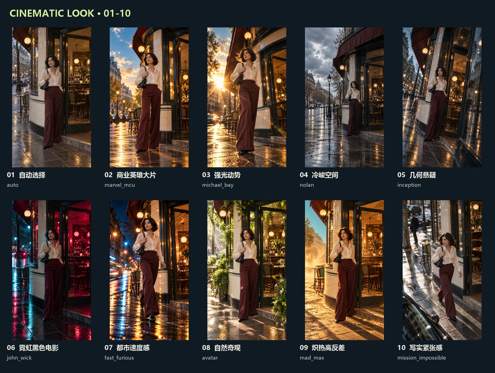
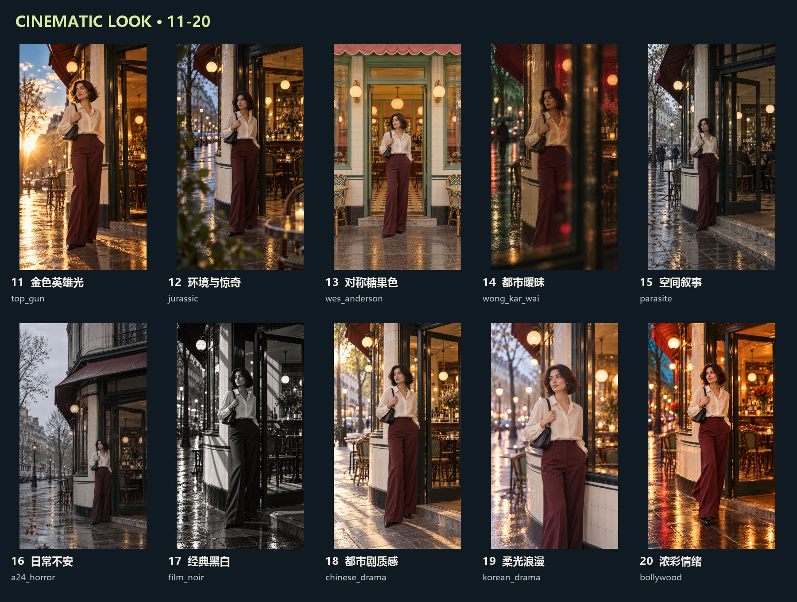
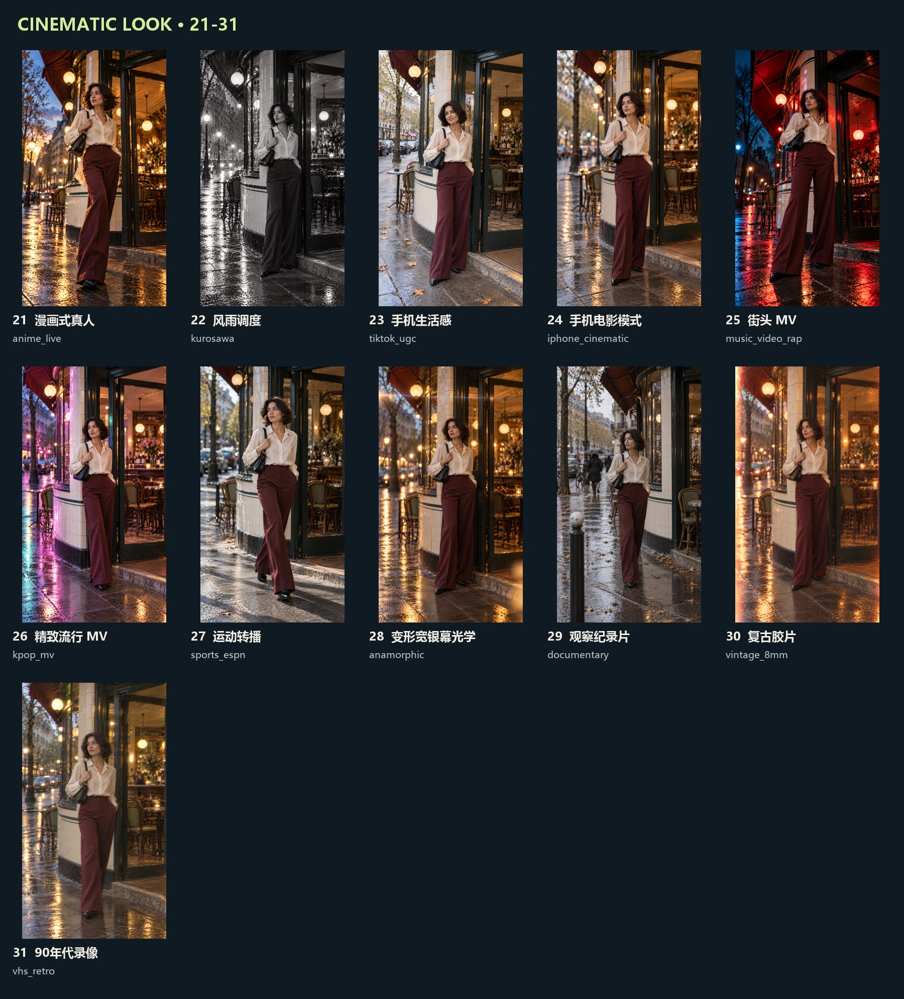

# 31 种电影观感 · 图文样品库

同一虚构成年模特、同一服装和咖啡馆的独立生成参考，展示构图、光色和摄影观感。每项只是一种视觉解读，不是Studiova后台结果。静态样品不能证明视频运镜、声音或节奏效果。

下载整个仓库后，在本机打开 [index.html](index.html)，可以筛选、放大、双图对比及复制选项。GitHub网页本身显示HTML源代码，不执行图库。下面的图文索引可直接在GitHub浏览。

| 编号 | 风格 / 代码 | 观感与原图 |
|---|---|---|
| 01 | AI Decides / auto | [自动选择](images/01-auto.png)：平衡曝光、自然色彩、适度景深 |
| 02 | Marvel / MCU / marvel_mcu | [商业英雄大片](images/02-marvel_mcu.png)：低机位、轮廓光、鲜明反差 |
| 03 | Michael Bay (Transformers) / michael_bay | [强光动势](images/03-michael_bay.png)：低广角、金色逆光、耀斑 |
| 04 | Christopher Nolan (Interstellar) / nolan | [冷峻空间](images/04-nolan.png)：冷灰色、厚重反差、空间尺度 |
| 05 | Inception / Mind-Bending / inception | [几何悬疑](images/05-inception.png)：几何线条、倾斜视角、空间张力 |
| 06 | John Wick / Neo-noir Action / john_wick | [霓虹黑色电影](images/06-john_wick.png)：青紫霓虹、黑位、湿地反射 |
| 07 | Fast & Furious / fast_furious | [都市速度感](images/07-fast_furious.png)：低角度、街灯光轨、动势 |
| 08 | James Cameron (Avatar) / avatar | [自然奇观](images/08-avatar.png)：青绿层次、体积光、自然纵深 |
| 09 | Mad Max: Fury Road / mad_max | [炽热高反差](images/09-mad_max.png)：赭金色、青天空、强轮廓 |
| 10 | Mission Impossible / mission_impossible | [写实紧张感](images/10-mission_impossible.png)：斜向构图、硬光、动作清晰 |
| 11 | Top Gun: Maverick / top_gun | [金色英雄光](images/11-top_gun.png)：夕阳轮廓、暖肤色、开阔感 |
| 12 | Spielberg / Jurassic Park / jurassic | [环境与惊奇](images/12-jurassic.png)：前景层次、环境尺度、反应 |
| 13 | Wes Anderson / wes_anderson | [对称糖果色](images/13-wes_anderson.png)：正中对称、粉彩、平直构图 |
| 14 | Wong Kar-wai (In the Mood) / wong_kar_wai | [都市暧昧](images/14-wong_kar_wai.png)：遮挡、红绿光、亲密留白 |
| 15 | Bong Joon-ho (Parasite) / parasite | [空间叙事](images/15-parasite.png)：建筑线条、深景、克制色彩 |
| 16 | A24 Horror (Hereditary / Midsommar) / a24_horror | [日常不安](images/16-a24_horror.png)：大留白、冷白光、静止感 |
| 17 | Classic Film Noir / film_noir | [经典黑白](images/17-film_noir.png)：黑白、硬阴影、定向光 |
| 18 | Chinese Drama (C-Drama) / chinese_drama | [都市剧质感](images/18-chinese_drama.png)：干净人物、暖中性色、生活感 |
| 19 | Korean Drama (K-Drama) / korean_drama | [柔光浪漫](images/19-korean_drama.png)：奶油高光、柔焦散景、轻粉彩 |
| 20 | Bollywood Masala / bollywood | [浓彩情绪](images/20-bollywood.png)：浓郁暖色、情绪、衣料动感 |
| 21 | Anime Live-Action / anime_live | [漫画式真人](images/21-anime_live.png)：图形构图、鲜明姿态、冷暖对比 |
| 22 | Kurosawa / Samurai Epic / kurosawa | [风雨调度](images/22-kurosawa.png)：风雨、深层空间、硬朗黑白 |
| 23 | TikTok / Viral UGC / tiktok_ugc | [手机生活感](images/23-tiktok_ugc.png)：近距离、广景深、自然曝光 |
| 24 | iPhone Cinematic Mode / iphone_cinematic | [手机电影模式](images/24-iphone_cinematic.png)：自然肤色、主体清晰、浅景深 |
| 25 | Hip-hop / Rap Music Video / music_video_rap | [街头 MV](images/25-music_video_rap.png)：低广角、强色块、表演姿态 |
| 26 | K-Pop Music Video / kpop_mv | [精致流行 MV](images/26-kpop_mv.png)：糖果光、整洁构图、通透细节 |
| 27 | Sports / ESPN Broadcast / sports_espn | [运动转播](images/27-sports_espn.png)：高速定格、长焦、清晰动作 |
| 28 | Anamorphic Widescreen / anamorphic | [变形宽银幕光学](images/28-anamorphic.png)：横向耀斑、椭圆散景、纵深 |
| 29 | Documentary / Cinéma Vérité / documentary | [观察纪录片](images/29-documentary.png)：现场光、抓拍、真实肌理 |
| 30 | Vintage Super 8mm / vintage_8mm | [复古胶片](images/30-vintage_8mm.png)：颗粒、柔反差、暖色褪色 |
| 31 | VHS / Retro 90s / vhs_retro | [90年代录像](images/31-vhs_retro.png)：低清、色彩溢出、磁带质感 |

[全部实际生成提示词](prompts.md) · [样品目录JSON](manifest.json)
